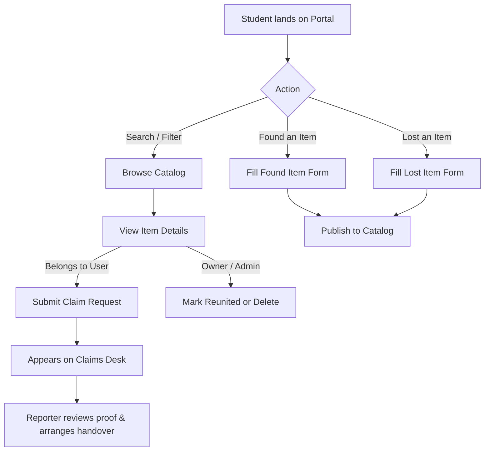

# 🎓 Campus Lost & Found Portal

[](https://reactjs.org/)
[](https://vitejs.dev/)
[](https://www.w3.org/Style/CSS/)
[](LICENSE)
[](#-dark--light-mode)
[](#)

A modern, responsive, and student-centric **Campus Lost and Found Portal** built with **React** and **Vite**. Designed to replace messy campus noticeboards and fragmented group chats with a centralized, secure, and user-friendly digital lost & found hub for universities and colleges.

---

## 📑 Table of Contents

- [Project Description](#-project-description)
- [Key Features](#-key-features)
- [Architecture & Tech Stack](#-architecture--tech-stack)
- [Project Structure](#-project-structure)
- [Quick Start Guide](#-quick-start-guide)
  - [Option A: One-Click Launch (Windows)](#option-a-one-click-launch-windows)
  - [Option B: Command Line (npm)](#option-b-command-line-npm)
- [User Workflows](#-user-workflows)
  - [1. Reporting a Lost or Found Item](#1-reporting-a-lost-or-found-item)
  - [2. Claiming an Item with Proof of Ownership](#2-claiming-an-item-with-proof-of-ownership)
  - [3. Claims & Inquiries Desk](#3-claims--inquiries-desk)
  - [4. Marking as Reunited / Resolved](#4-marking-as-reunited--resolved)
- [Data Model & Schema](#-data-model--schema)
- [Design & Aesthetics](#-design--aesthetics)
- [Future Enhancements](#-future-enhancements)
- [Troubleshooting](#-troubleshooting)
- [License](#-license)

---

## 🌟 Project Description

The Campus Lost & Found Portal is a modern React and Vite web app that helps university students report lost items, list found belongings, and securely verify ownership. Featuring real-time search, category filters, an ownership claim desk, and dark mode, it streamlines campus recovery in a fast, responsive platform.

---

## ✨ Key Features

### 🔍 Real-Time Search & Filtering
- **Faceted Filtering**: Filter by listing type (`All`, `Lost Only`, `Found Only`, or `Reunited/Resolved`).
- **Category Tabs**: Filter through 8 curated campus categories with visual color indicators:
  - 💻 Electronics (Laptops, phones, headphones, chargers)
  - 📚 Books & Stationery (Textbooks, notebooks, binders)
  - 🎒 Bags & Accessories (Backpacks, wallets, sunglasses)
  - 🪪 Identity Cards & Documents (Campus IDs, driver licenses)
  - 👕 Clothing & Apparel (Jackets, hoodies, lab coats)
  - 🔑 Keys (Dorm keys, car fobs, bike lock keys)
  - 💧 Water Bottles & Flasks (Insulated bottles, tumblers)
  - 📦 Other & Miscellaneous (Umbrellas, sports equipment)
- **Deep Search**: Live full-text search matching item titles, campus buildings/rooms, descriptions, and reporter names.
- **Sorting Options**: Sort by newest reports, oldest reports, or alphabetically.

### 📊 Live Statistics Dashboard
- Real-time counters showing:
  - **Active Lost Items** awaiting recovery
  - **Found Belongings** safely reported on campus
  - **Reunited Items** successfully restored to owners
  - **Campus Recovery Rate (%)** calculating community resolution rate

### 📝 Comprehensive Reporting Workflow
- Two specialized modes: **"I Lost Something"** and **"I Found An Item"**.
- Form validation for required fields: Title, Category, Date, Campus Location, Description, and Student Contact.
- **Secret Identifying Details**: Store unique identifiers (e.g. stickers, serial code hints, wallpaper, inner pouch contents) used to verify authentic claims.
- **Photo Integration**: Direct image URL support with a quick-select gallery of popular campus item stock presets for instant testing.

### 🤝 Verification & Claims Workflow
- **Item Details Modal**: Comprehensive modal showing high-resolution photo, location, date, full description, and reporter contact card.
- **Claim Request Modal**: Allows potential owners to submit a claim with their university email, phone, and detailed proof of ownership.
- **Claims Desk**: Dedicated management modal showing all pending claim requests with timestamps, claimant details, and submitted proof.

### 🌓 Dark / Light Mode
- Custom crafted dark and light themes with smooth transitions.
- Automatic persistence in `localStorage` (`campus_theme`).
- Accessible contrast ratios, crisp typography, and glassmorphic navigation bars.

### 💾 LocalStorage & Demo Data
- New reports, status toggles, claims, and deletions persist instantly in browser storage.
- Includes a **"Reset Demo Data"** action in the footer to restore the original 10+ realistic campus sample items at any time.

---

## 🛠 Architecture & Tech Stack

| Layer | Technology | Details |
| :--- | :--- | :--- |
| **Runtime / Library** | React 18.3 | Function components, React Hooks (`useState`, `useEffect`, `useMemo`) |
| **Build Tooling** | Vite 5.4 | Ultra-fast HMR (Hot Module Replacement) and optimized production builds |
| **Styling** | Vanilla CSS | CSS variables, responsive CSS Grid / Flexbox, glassmorphic backdrop filters |
| **Typography** | Google Fonts | *Plus Jakarta Sans* (body & UI) and *Outfit* (headers & brand display) |
| **Icons** | Inline SVG | Lightweight, zero-dependency, scalable SVG icons |
| **Persistence** | Web Storage API | `localStorage` for items, claims, and active theme preference |
| **Scripts** | Windows Batch (`.bat`) | Double-click instant server launch and browser opening |

---

## 📂 Project Structure

```text
mini-project/
├── start-app.bat                # ⚡ 1-click launcher for the entire portal
├── README.md                    # 📖 Project documentation
└── campus-lost-found/           # 📦 Application root
    ├── dist/                    # 🚀 Production build output (generated by vite build)
    ├── index.html               # 🌐 Main HTML entry point with meta tags & Google fonts
    ├── package.json             # 📋 Dependencies, scripts, and project metadata
    ├── package-lock.json        # 🔒 Exact dependency lockfile
    ├── start.bat                # ⚡ Local launcher inside project directory
    └── src/
        ├── App.jsx              # ⚛️ Core application (components, modals, state, business logic)
        ├── App.css              # 🎨 Comprehensive styling (tokens, themes, components, responsiveness)
        ├── main.jsx             # 🚀 React DOM root hydration
        └── data/
            ├── items.json       # 🗃️ Initial sample campus lost & found listings
            ├── categories.json  # 🏷️ Campus category taxonomy with icons & accent colors
            └── users.json       # 👥 Mock university students and campus safety officers
```

---

## 🚀 Quick Start Guide

### Option A: One-Click Launch (Windows)

Simply double-click the included batch launcher:
```bat
start.bat
```
*(or run `start-app.bat` from the root folder)*

This batch file will:
1. Start the local Vite development server.
2. Automatically open `http://localhost:5173/` in your default web browser.

---

### Option B: Command Line (npm)

#### Prerequisites
- [Node.js](https://nodejs.org/) (Version 18.x or newer recommended)
- `npm` (bundled with Node.js)

#### 1. Navigate into this application folder
```bash
cd campus-lost-found
```

#### 2. Install dependencies (if first time)
```bash
npm install
```

#### 3. Start development server
```bash
npm run dev
```
Open your browser and navigate to the displayed URL:
```
http://localhost:5173/
```

#### 4. Build for production (optional)
To compile and bundle the static application for production hosting (Vercel, Netlify, GitHub Pages, etc.):
```bash
npm run build
```
The output files will be generated in `dist/`.

#### 5. Preview production build
```bash
npm run preview
```

---

## 🔄 User Workflows



### 1. Reporting a Lost or Found Item
1. Click the **"Report Item"** button in the header or hero banner.
2. Select whether you **Lost** an item or **Found** an item.
3. Enter the item name, select the campus category, specify the date and exact campus location (e.g. *Central Library 2nd Floor*).
4. Add description notes, optional photo URL (or click one of the quick photo presets).
5. *(Recommended)* Add **Secret Identifying Details** (e.g. keychain detail, laptop sticker, engravement) to verify future claimants.
6. Submit the form. The listing will immediately appear in the catalog and update dashboard statistics.

### 2. Claiming an Item with Proof of Ownership
1. Browse or search the catalog to find the lost belonging.
2. Click **"View Details"** on the card.
3. Click **"Contact Reporter / Claim Item"**.
4. Enter your name, student email, phone number, and a detailed message describing verifiable proof of ownership.
5. Submit your claim.

### 3. Claims & Inquiries Desk
- Access the **Claims Desk** from the navigation drawer or footer to view all submitted claims and inquiries across campus items.
- Check claimant contact information and review their verification answers.

### 4. Marking as Reunited / Resolved
- When an item has been safely returned to its rightful owner, click the checkmark button on the card or the **"Mark as Resolved & Returned"** button inside the details modal.
- The item will be badged as **"✓ Returned"**, will be grouped under the **"Reunited"** tab, and will boost the campus **Recovery Rate** statistic.
- Items can be reopened as active at any time if needed.

---

## 📊 Data Model & Schema

Each item in `src/data/items.json` follows this structured JSON format:

```json
{
  "id": "item-001",
  "name": "Sony WH-1000XM4 Noise-Cancelling Headphones",
  "type": "Lost",
  "categoryId": "electronics",
  "description": "Black over-ear wireless headphones in original zippered case...",
  "date": "2026-10-14",
  "createdAt": "2026-10-14T14:20:00.000Z",
  "location": "Central Library - 2nd Floor Silent Study Pods",
  "imageUrl": "https://images.unsplash.com/photo-1505740420928-5e560c06d30e?w=800",
  "userId": "user-001",
  "contactName": "Maya Lin",
  "contactEmail": "maya.lin@campus.edu",
  "status": "Active",
  "details": "Includes high-speed USB-C charging cord inside inner mesh pouch."
}
```

---

## 🎨 Design & Aesthetics

- **Color Palette**:
  - Primary Accent: University Electric Blue (`#2563eb` / `#3b82f6`)
  - Lost Status: Coral Red (`#ef4444` / `#fee2e2`)
  - Found Status: Emerald Green (`#10b981` / `#d1fae5`)
  - Resolved Status: Violet Purple (`#8b5cf6` / `#ede9fe`)
- **Theme Support**: Seamless toggle between clean Light mode and sleek Dark mode.
- **Glassmorphism**: Subtle translucent backdrops with `backdrop-filter: blur(16px)` on navigation and modal overlays.
- **Mobile First**: Adaptive pagination, collapse menu drawer, and touch-friendly controls.

---

## 🔮 Future Enhancements

- [ ] **Backend Integration**: Replace `localStorage` with a persistent database (PostgreSQL, Supabase, or MongoDB).
- [ ] **University Single Sign-On (SSO)**: Authenticate with Google Workspace or Microsoft Azure AD using `@campus.edu` emails.
- [ ] **Interactive Campus Map**: Pinpoint items on an interactive campus map (Leaflet / Mapbox).
- [ ] **AI-Assisted Image Matching**: Automatically match newly reported found items with existing lost item descriptions and photos.
- [ ] **Email / SMS Notifications**: Automatically email student reporters when a claim is submitted.

---

## ❓ Troubleshooting

| Issue | Cause | Solution |
| :--- | :--- | :--- |
| `start.bat` fails with path error | Node.js path is different on your system | Open `start.bat` and ensure `npm` points to your active Node installation, or simply run `npm run dev` in this directory |
| Port 5173 is already in use | Another Vite or dev process is running | Vite will automatically use the next available port (e.g. `5174`). Follow the terminal URL |
| Resetting data to fresh state | You want to clear edited/test items | Click **"Reset Demo Data"** in the footer, or clear your browser's local storage for `localhost` |

---

## 📄 License

This project is licensed under the [MIT License](LICENSE) - open for university, educational, and personal use.
